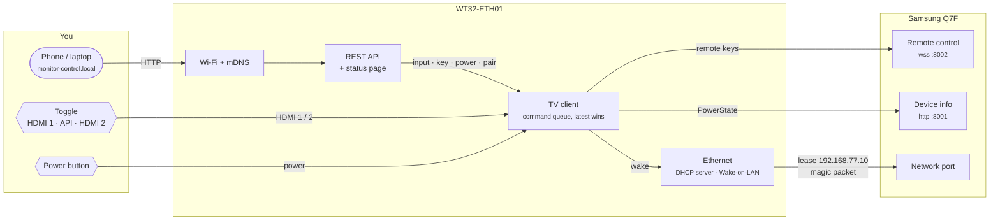
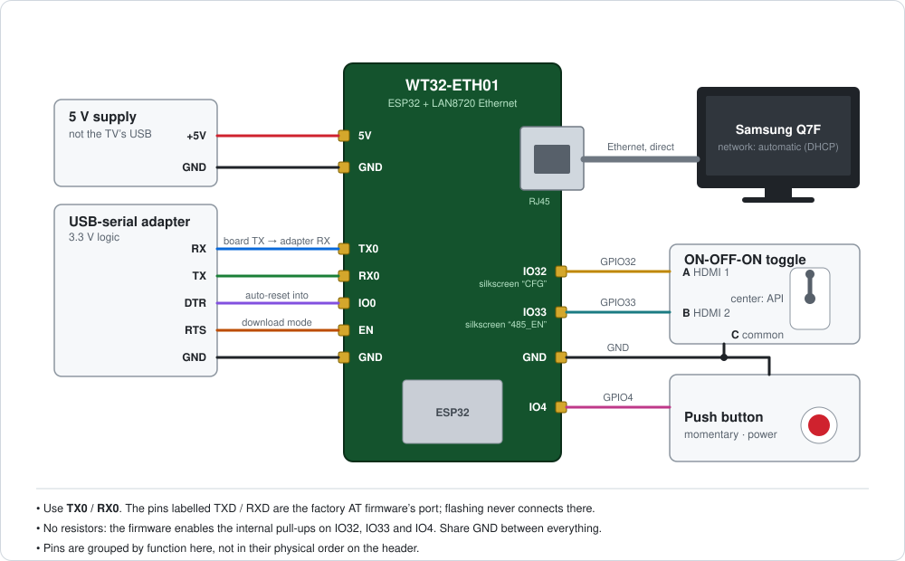

# Monitor Control

A small network box that switches a Samsung Q7F TV between **HDMI 1** and
**HDMI 2** (and turns it on and off) from a physical toggle, a button, or a REST API.

It runs on a **WT32-ETH01** (ESP32 + Ethernet). The TV is cabled straight to the
board's Ethernet port, on a private link with no route to your network. The
board joins your Wi-Fi to serve the API.



## What it does

- **Toggle (3-position):** the outer positions switch to HDMI 1 or HDMI 2 and
  lock out the API. The center hands control to the API.
- **Power button:** turns the TV off (`KEY_POWER`) or on (Wake-on-LAN). On
  power-on, it also switches to the toggle's input.
- **REST API and status page** at `http://monitor-control.local/`.
- **Switch time:** about 2 s.

The TV ignores the direct HDMI keys and can't report its current input. The
board therefore switches by opening the Source menu, pressing Up past the top
(TV), then Down to the input, then Enter. See
[the findings](docs/plans/01_experimentation/findings.md) for how that was
worked out.

## Getting started

1. **Wire it up and flash it:** follow [firmware/README.md](firmware/README.md).
   Power the board from its own 5 V supply, not the TV's USB port.

   

2. **Set the TV's network to automatic (DHCP)** and cable it to the board.
3. **Pair once:** flip the toggle (or `POST /api/pair`) and accept the prompt
   on the TV.

## API

| Request | Effect |
|---|---|
| `GET /api/status` | Toggle mode, last input, TV, DHCP and Wi-Fi state |
| `POST /api/input/1`, `/api/input/2` | Switch input (`409` unless the toggle is centered) |
| `POST /api/power` | Toggle TV power |
| `POST /api/key/KEY_NAME` | Send one remote key (`409` unless centered) |
| `POST /api/pair` | Pair with the TV again |
| `GET /api/log` | Last 16 commands with timings |

```bash
curl -X POST http://monitor-control.local/api/input/2
curl -s http://monitor-control.local/api/status | python3 -m json.tool
```

There's no authentication: anyone on your network can switch inputs while the
toggle is centered.

## Repository

| Path | Contents |
|---|---|
| [firmware/](firmware/) | ESP-IDF firmware for the WT32-ETH01: wiring, build, flash, API details |
| [poc/](poc/) | The Mac proof of concept. `dhcpd.py` is a raw-packet DHCP server; `tvctl.py` is a TV remote CLI |
| [docs/plans/](docs/plans/) | Plans and findings for each phase: [01 experimentation](docs/plans/01_experimentation/plan.md), [02 ESP32](docs/plans/02_esp32/plan.md) |

The PoC tools still work for experiments from a Mac with the TV cabled to it.
Their defaults (TV at `192.168.2.10`, Ethernet on `en5`) match that setup, not
the board's.

```bash
python3 poc/dhcpd.py --pin <tv-mac>=192.168.2.10       # serve DHCP on en5, no sudo
python3 -m venv .venv && .venv/bin/pip install -r poc/requirements.txt
.venv/bin/python poc/tvctl.py pair                    # then: hdmi 1|2, key KEY_…, info
```
